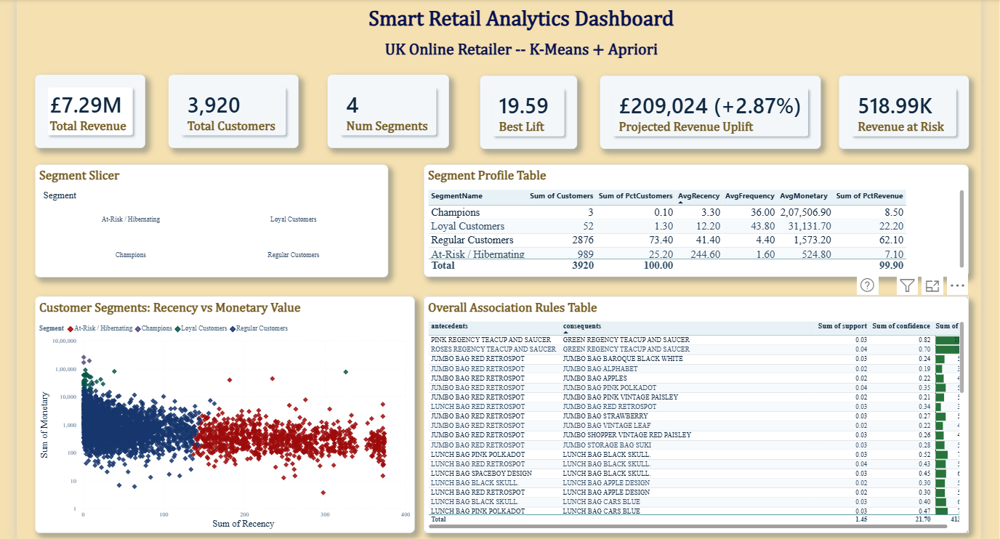
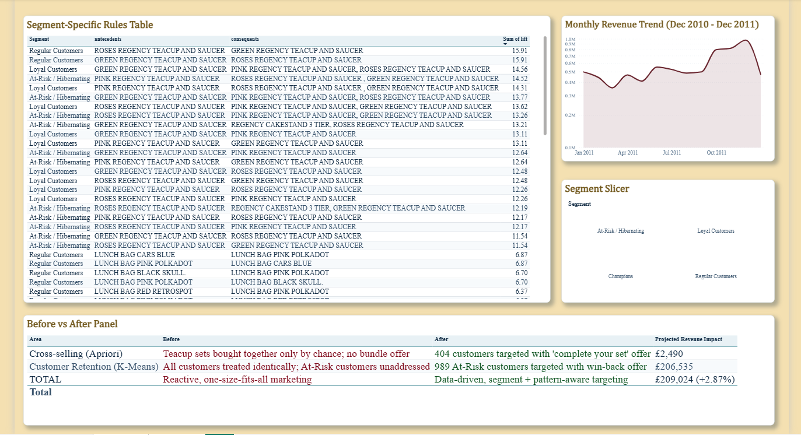

# Retail Customer Analytics & Segmentation

Customer segmentation using **RFM and K-Means**, combined with **Apriori market basket analysis**, to uncover customer behaviour, product associations and potential business opportunities in a UK online retailer.

Developed as part of my Data Mining & Warehousing case study.

---
[](https://smart-retail-analytic.streamlit.app/)

**Live demo: [smart-retail-analytic.streamlit.app](https://smart-retail-analytic.streamlit.app/)**

> Runs on Streamlit Community Cloud. Free apps sleep after inactivity, so if you see a "wake up" button, click it and wait a few seconds.

## 📊 Power BI Dashboard Preview

### Dashboard – Page 1


### Dashboard – Page 2


---

## 1. Problem Statement

Retailers generate large volumes of transaction data, but often miss opportunities to use it effectively.

This project explores three key business challenges:

- **Missed product opportunities:** Products frequently purchased together are not always promoted as bundles.
- **Lack of customer differentiation:** Loyal customers and occasional buyers may receive the same marketing approach.
- **Customer inactivity:** Customers who gradually stop purchasing may go unnoticed.

The objective was to use data mining techniques to identify actionable patterns and support better business decisions.

## 2. Dataset

**Source:** [UCI Online Retail Dataset](https://archive.ics.uci.edu/dataset/352/online+retail)

The dataset contains UK retail transactions from December 2010 to December 2011.

| Dataset Metric | Count |
|---|---:|
| Raw UK transactions | 495,478 |
| Transactions after cleaning | 354,321 |
| Unique customers | 3,920 |
| Unique products | 3,833 |

**Data preprocessing:**
- Removed cancelled invoices (InvoiceNo starting with `C`).
- Removed records with missing CustomerID.
- Removed zero or negative quantities and prices.
- Removed duplicate records.
- Created `TotalPrice = Quantity × UnitPrice`.

The dataset is included in the repository under `data/online_retail_uk.csv`.

## 3. Methodology & Analysis

### A. Customer Segmentation – RFM + K-Means

Customers were evaluated using three RFM metrics:

- **Recency:** How recently a customer purchased.
- **Frequency:** How often a customer purchased.
- **Monetary:** How much a customer spent.

Features were scaled using `StandardScaler`. The number of clusters was evaluated using the Elbow Method and Silhouette Score. Four clusters were selected to balance statistical fit with business interpretability.

| Customer Segment | Customers | Characteristics |
|---|---:|---|
| Champions | 3 | Very high spend |
| Loyal Customers | 52 | Frequent buyers |
| Regular Customers | 2,876 | Largest customer group |
| At-Risk / Hibernating | 989 | Inactive for roughly 8 months |

### B. Market Basket Analysis – Apriori

Association rule mining was performed on the 100 most frequently purchased products overall and separately within eligible customer segments.

Rules were evaluated using:
- Support
- Confidence
- Lift

**Key findings:**
- Pink, Green and Roses Regency Teacup and Saucer sets showed a strong association, with a lift of approximately 19.6.
- Regular and Loyal customer segments showed a Gardener's Kneeling Pad purchasing pattern that was not evident when analysing all customers together.

### C. Reliability Check

The Champions segment contained only three customers. Running Apriori on such a small group generated numerous perfect-looking but unreliable rules.

To address this, a minimum segment size of 10 customers was introduced for pattern-level analysis. The Champions segment was excluded from segment-specific association rule mining.

This helped avoid interpreting patterns from extremely small samples as meaningful customer behaviour.

## 4. Business Impact – Scenario Projection

The analysis was translated into potential business opportunities using assumed conversion rates.

| Business Opportunity | Projected Value |
|---|---:|
| Teacup complete-your-set bundle | ~£2,490 |
| At-Risk customer win-back campaign | ~£206,535 |
| **Total projected opportunity** | **~£209,024** |

The estimated opportunity represents approximately 2.87% of revenue.

**Important:** These are scenario-based projections, not measured campaign results. They assume a 25% conversion rate for the bundle offer and a 20% conversion rate for the win-back campaign.

The assumptions can be modified using `CONVERSION_ASSUMPTION` and `WINBACK_CONVERSION` in the notebook.

## 5. Power BI Dashboard

The Power BI dashboard translates the analytical findings into an interactive business reporting experience.

**Page 1 – Customer Analytics**
- Revenue and customer KPI cards.
- Recency vs Monetary scatter plot by customer segment.
- Customer segment profiles.
- Overall association rules.
- Segment-level filtering.

**Page 2 – Business Insights**
- Monthly revenue trends.
- Segment-specific association rules.
- Before-and-after business impact analysis.

The complete dashboard is available in `dashboard/Retail_Analytics_Dashboard.pbix`.

## 6. Repository Structure

```text
smart-retail-analytics/
│
├── app.py
├── data/
│   └── online_retail_uk.csv
│
├── notebook/
│   └── online_retail.ipynb
│
├── dashboard/
│   └── Retail_Analytics_Dashboard.pbix
│
├── presentation/
│   └── Smart_Retail_Analytics_Presentation.pptx
│
├── images/
│   ├── Dashboard_pg1.png
│   └── Dashboard_pg2.png
│
├── requirements.txt
└── README.md
```

## 7. Running the Project

Clone the repository:

```bash
git clone https://github.com/RaginiGupta21/smart-retail-analytics.git

cd smart-retail-analytics
```

Install the required dependencies:

```bash
pip install -r requirements.txt
```

**To run the analysis notebook:**

```bash
jupyter notebook notebook/online_retail.ipynb
```

Execute the notebook cells sequentially to reproduce the analysis and generate the output CSV files used by the Power BI dashboard.

**To run the Streamlit application:**

```bash
streamlit run app.py
```

**To explore the Power BI dashboard:**

Open `dashboard/Retail_Analytics_Dashboard.pbix` using Power BI Desktop.

## 8. Limitations

- Apriori analysis was restricted to the top 100 products overall and 80 products per eligible segment to manage computational complexity.
- Business impact estimates depend on assumed conversion rates.
- The dataset covers a single retailer over one year, so seasonal patterns may influence the results.
- RFM-based customer segments require validation against actual campaign responses before operational use.

## 9. Future Scope

- Forecast product demand for better inventory planning.
- Evaluate win-back campaigns through A/B testing.
- Automate monthly customer segmentation.
- Extend market basket analysis to a wider range of products.

## 10. Technologies Used

Python | Pandas | Scikit-learn | MLxtend | Jupyter Notebook | Power BI | Streamlit

## Reference

Chen, D. (2015). *Online Retail Data Set*. UCI Machine Learning Repository.

---

**Ragini Gupta**  
BSc Data Science & Business Analytics

[LinkedIn](https://www.linkedin.com/in/raginigupta21)
